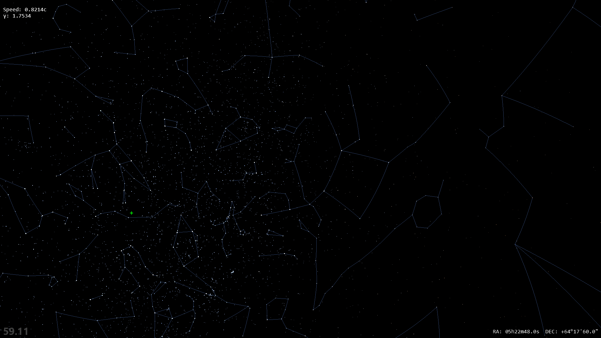

# Relativistic Starfield


Relatively simple Python script to simulate relativistic light aberration and the Doppler Effect.

It uses an actual star map from the Bright Stars Catalogue. The stars are classified according to their stellar type, from which their temperature is roughly inferred, and then converted into RGB color based on the algorithm by Tanner Helland.

The settings for brightness change and the Doppler shift are set empirically. In reality, you likely wouldn't notice the blue shift against the overall brightness increase.

## Features

- All ~9,100 stars of the Bright Star Catalogue, rendered with OpenGL.
- **Relativistic aberration:** as you speed up, the sky crowds towards your direction of travel.
- **Doppler shift:** stars ahead turn bluer and brighter, stars behind turn redder and dimmer.
- **Constellation lines** that distort along with the stars. Each line is subdivided along its arc,
  so it curves correctly instead of being drawn as a straight segment between the moved stars.
- Additive blending, so overlapping starlight adds up as real light does.
- Frame-rate independent controls; runs at your monitor's refresh rate.

## Running

Requires Python 3 (tested with 3.13).

```
pip install numpy pandas pyglet moderngl pyrr
python main.py
```

## Controls

| Key | Action |
|---|---|
| Left mouse drag / WASD | Look around |
| Up / Down | Speed up / slow down (up to 0.99999c) |
| Space | Travel in the direction you're looking |
| R | Reset speed and direction |
| C | Toggle constellation lines |
| M | Toggle direction markers (green ahead, red behind) |
| B | Toggle additive blending |
| F | Toggle fullscreen |
| H | Show / hide the on-screen instructions |
| Esc | Quit |

## Data

- `bsc5.txt`: the Bright Star Catalogue.
- `data_processing.py` converts it to `bright_stars.csv`, the catalogue used by `main.py`
  (positions, magnitudes and temperatures estimated from spectral types via `spec_type.csv`).
- `constellation_processing.py` builds `constellation_lines.csv` from
  [d3-celestial](https://github.com/ofrohn/d3-celestial)'s constellation lines, matching each line
  endpoint to the nearest catalogue star. See [THIRD_PARTY_NOTICES.md](THIRD_PARTY_NOTICES.md) for its license.

## Plans

Moving the relativistic calculations into the vertex shader, which would allow much larger star
catalogues. See [GPU_SHADER_PLAN.md](GPU_SHADER_PLAN.md).
